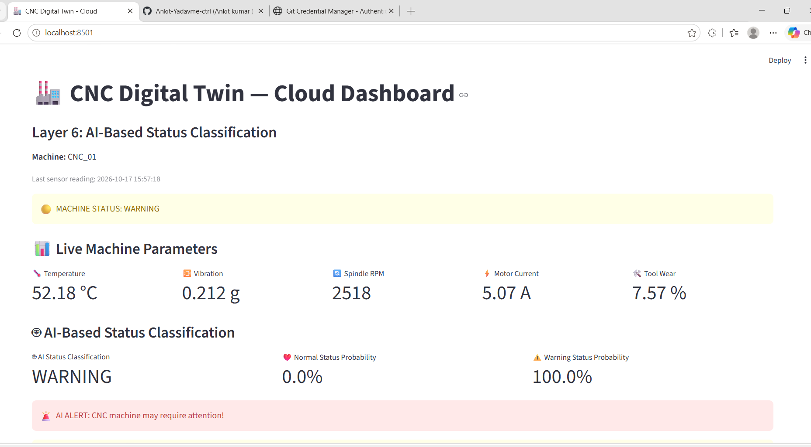

\# CNC Digital Twin — AI-Driven Smart Manufacturing


A student project exploring real-time CNC machine monitoring using MQTT, Python, Streamlit, and machine-learning experiments.


\## Features


\- \*\*Live telemetry pipeline:\*\* Simulated CNC sensor data is published using MQTT through HiveMQ Cloud.

\- \*\*Monitoring dashboard:\*\* Streamlit displays temperature, vibration, spindle RPM, motor current, tool wear, and machine status.

\- \*\*Data logging:\*\* The MQTT receiver stores incoming readings in a local CSV file.

\- \*\*Offline ML experiments:\*\* PHM2010 cutting-tool data is used for feature extraction, model comparison, and wear-prediction evaluation.


\## Architecture


1\. Python simulator generates synthetic CNC sensor readings.

2\. Paho MQTT publishes messages to HiveMQ Cloud.

3\. An MQTT receiver subscribes to the topic and saves readings locally.

4\. Streamlit reads the CSV and presents the dashboard.

5\. Separate offline scripts analyze PHM2010 data and evaluate ML models.


\*\*MQTT topic:\*\* `factory/cnc/CNC\_01/sensors`


\## Technologies


Python, Streamlit, Pandas, NumPy, scikit-learn, Matplotlib, Joblib, Paho MQTT, HiveMQ Cloud, Git, and GitHub.


\## Setup


\### 1. Clone the repository


```bash

git clone YOUR\_GITHUB\_REPOSITORY\_URL

cd CNC\_Digital\_Twin

```


\### 2. Install dependencies


```bash

python -m pip install -r requirements.txt

```


\### 3. Configure HiveMQ Cloud credentials


Set these environment variables in your terminal:


\- `HIVEMQ\_BROKER`

\- `HIVEMQ\_PORT`

\- `HIVEMQ\_USERNAME`

\- `HIVEMQ\_PASSWORD`


Never commit credentials or `.env` files.


\### 4. Start the MQTT receiver


Configure the environment variables in the receiver's terminal, then run:


```bash

python mqtt/hivemq\_to\_csv.py

```


\### 5. Start the simulator


In a separate terminal with the same MQTT environment variables, run:


```bash

python generator/synthetic\_data\_hivemq.py

```


\### 6. Start the dashboard


Set `DASHBOARD\_USERNAME` and `DASHBOARD\_PASSWORD` in the dashboard terminal, then run:


```bash

python -m streamlit run app.py

```


Open the local URL printed by Streamlit.


\## Important limitations


\- Live sensor readings are \*\*simulated\*\*, not collected from a physical CNC machine.

\- PHM2010 modelling is a separate offline research component.

\- Experimental wear models showed limited generalization on chronological test data. Their predictions should not be treated as validated industrial measurements.

\- The dashboard's failure-prediction model must be independently validated before its results are used for real maintenance decisions.

\- The demo login is not production-grade authentication.


\## Security


Keep broker passwords, dashboard credentials, raw datasets, generated telemetry, and private model files out of public version control. Configure credentials through environment variables.


\## Future improvements


\- Validate models on additional operating conditions.

\- Connect physical sensors to the MQTT pipeline.

\- Improve authentication and model monitoring.

\- Add automated tests and reproducible evaluation reports.

## 📸 Live Dashboard

The CNC Digital Twin dashboard displays live sensor telemetry received through MQTT, including temperature, vibration, spindle RPM, motor current, and tool wear. It also shows AI-based machine-status classification and warning alerts.



